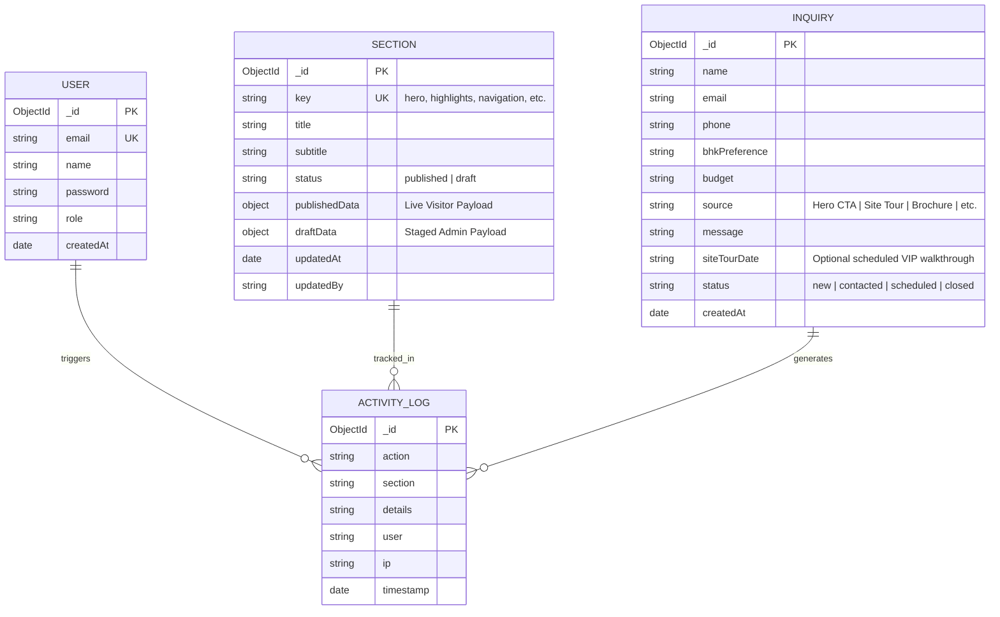

# Database Schema & Data Dictionary

## Architecture Overview

The **Codename ONE Real Estate Platform** implements a **Dual-Engine Persistence Architecture**:
1. **Primary Enterprise Tier**: **MongoDB with Mongoose ODM** (designed for distributed scale, flexible document schema for dynamic CMS section trees, indexing on buyer search inquiries).
2. **Resilient Local High-Availability Tier**: Embedded JSON datastore with file-locking and atomic transactions, guaranteeing that the platform runs out-of-the-box in zero-configuration local, staging, or CI test environments.

---

## Entity Relationship Diagram (ERD)

---

## Collections & Schema Definitions

### 1. `sections` Collection
Stores modular dynamic CMS configurations. Supports two-phase staging (**Draft/Publish**) so changes can be prepared and reviewed without disrupting live visitors.

| Field Name | Type | Constraints | Description |
|---|---|---|---|
| `_id` | ObjectId / String | Primary Key | Unique document identifier |
| `key` | String | Unique, Indexed | Machine slug (e.g., `hero`, `highlights`, `residences`, `amenities`, `connectivity`, `developer`, `seo`) |
| `title` | String | Required | Human-readable section title |
| `subtitle` | String | Optional | Secondary explanatory subtitle |
| `status` | String | Enum: `published`, `draft` | Current publication status |
| `publishedData` | Mixed / Object | Default `{}` | Live payload served to public visitors |
| `draftData` | Mixed / Object | Default `{}` | Staged payload modified by admin |
| `updatedAt` | Date | Default `now()` | Timestamp of last modification |
| `updatedBy` | String | Optional | Admin identity or system process |

#### Indexes:
- `key`: Unique Index (`{ key: 1 }, { unique: true }`)
- `status`: Secondary Index for fast filtering

---

### 2. `inquiries` Collection
Captures high-intent luxury buyer leads submitted across landing page CTAs, exclusive site tour bookings, and brochure downloads.

| Field Name | Type | Constraints | Description |
|---|---|---|---|
| `_id` | ObjectId / String | Primary Key | Unique lead identifier |
| `name` | String | Required, Trimmed | Buyer full legal name |
| `email` | String | Required, Valid Email | Buyer primary email address |
| `phone` | String | Required, Min 10 chars | Buyer mobile / WhatsApp contact number |
| `bhkPreference` | String | Default `3 & 4 BHK` | Preferred configuration (`3 BHK Grande`, `4 BHK Palatial`, etc.) |
| `budget` | String | Default `On Request` | Price band preference |
| `source` | String | Required | CTA attribution (`Hero Primary CTA`, `Signature Card`, `Brochure Download`) |
| `message` | String | Optional | Buyer notes, view preferences, floor requirements |
| `siteTourDate` | String | Optional | Confirmed appointment timestamp for private VIP walkthrough |
| `status` | String | Enum: `new`, `contacted`, `scheduled`, `closed` | Sales pipeline lifecycle stage |
| `createdAt` | Date | Default `now()`, Indexed | Timestamp of lead submission |

#### Indexes:
- `createdAt`: Descending Index for fast sorting (`{ createdAt: -1 }`)
- `status`: Index for pipeline filtering
- Text Index on `name`, `email`, `phone` for fast CRM search

---

### 3. `activity_logs` Collection
Audit log tracking content modifications, draft publications, status changes, and administrative actions for security and compliance.

| Field Name | Type | Constraints | Description |
|---|---|---|---|
| `_id` | ObjectId / String | Primary Key | Unique log identifier |
| `action` | String | Required | Action performed (e.g., `Draft Saved`, `Section Published`, `Inquiry Received`) |
| `section` | String | Required | Target entity or section slug |
| `details` | String | Optional | Detailed human-readable log summary |
| `user` | String | Default `Admin` | Responsible administrator or system trigger |
| `ip` | String | Default `127.0.0.1` | Originating IP address |
| `timestamp` | Date | Default `now()`, Indexed | Exact UTC timestamp |

---

### 4. `users` Collection
Stores administrative credentials and role-based access control (RBAC).

| Field Name | Type | Constraints | Description |
|---|---|---|---|
| `_id` | ObjectId / String | Primary Key | Unique user identifier |
| `email` | String | Unique, Required | Admin login email |
| `name` | String | Required | Full administrative name |
| `password` | String | Required | Bcrypt salt-hashed password string (cost factor 10) |
| `role` | String | Default `admin` | User role (`superadmin`, `editor`, `viewer`) |
| `createdAt` | Date | Default `now()` | Account provisioning timestamp |
